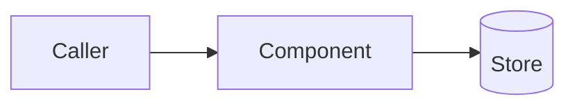

# Design: <title>

## Lite
<!-- rigor: lite may stop after this section. -->
- Approach in 3 sentences:
- Files/modules touched:
- Risks:

## Overview
<!-- How the system changes. Reference requirements by ID (AC-n). -->

## What must NOT change
<!-- Existing behavior, contracts and invariants this change must preserve. -->

## Components & data flow

## Interfaces / data model
<!-- New or changed APIs, schemas, events, config. -->

## Alternatives considered
| Option | Pros | Cons | Why not |
|---|---|---|---|

## Risks & mitigations
-

## Test strategy
<!-- Unit / integration / e2e; which ACs each level covers. -->

## Decisions
<!-- Hard-to-reverse choices → ADR in docs/adr/, linked here. -->

## Approval
- [ ] Human approved — name, date
