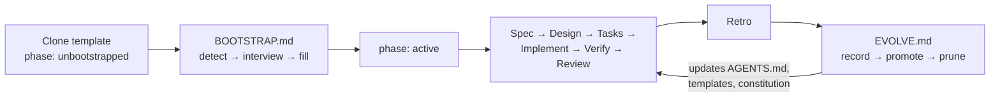

# agentic-sdlc-template

A GitHub template repository for starting any project with AI coding agents, using the
[AGENTS.md](https://agents.md) standard and a spec-driven Agentic SDLC.

After you create a repo from this template, your agent **bootstraps it** — interviews you, inspects
the code, and fills in the vision, constitution, architecture, commands and first spec. From then
on it **keeps customizing** the setup as it learns how you work.

<!-- BOOTSTRAP: Step 8 replaces everything above this line with the real project README. -->

## Quick start

1. On GitHub, click **Use this template → Create a new repository** (or clone and re-init).
2. Open the repo in your agent (Claude Code, Codex, Copilot, Cursor, Gemini CLI…).
3. Say: **"Bootstrap this repo."** In Claude Code you can also run `/bootstrap`.
4. Answer the one batch of questions, review the PR it opens, approve the first spec.

Works on existing codebases too: copy `AGENTS.md`, `CLAUDE.md`, `.agentic/`, `docs/`, `scripts/`
and `.github/` into the repo; bootstrap detects it as brownfield and documents what's there.

## How it works

| File | Role |
|---|---|
| `AGENTS.md` | The cross-tool contract every agent reads first |
| `CLAUDE.md` | One line, `@AGENTS.md`, so Claude Code reads the same contract |
| `.agentic/state.yml` | Where the repo is in its lifecycle (drives the agent's first action) |
| `.agentic/BOOTSTRAP.md` | One-time setup protocol |
| `.agentic/EVOLVE.md` | Continuous self-customization protocol |
| `.agentic/templates/` | Idea, requirements (EARS), design, tasks, ADR, retro |
| `docs/sdlc/` | Vision, constitution, architecture, glossary |
| `docs/specs/`, `docs/adr/` | Per-change specs and decisions |
| `docs/memory/` | Learnings and the evolution log |
| `.claude/commands/` | `/bootstrap`, `/spec`, `/evolve` for Claude Code |
| `scripts/check-agentic.sh` | Structural check, run in CI |

## Working with agents

- New feature: "Start a spec for …" (or `/spec …`). Approve requirements, then design.
- Correct the agent freely — corrections are recorded and promoted into the rules.
- Periodic tune-up: "Run the evolve review" (or `/evolve`).

## Making it your own template

Fork this repo, adjust `.agentic/` and the templates to your defaults, and mark it as a
template repository in GitHub settings. Bump `template.version` in `.agentic/state.yml` when you
change it, so downstream repos can sync (EVOLVE.md §5).
