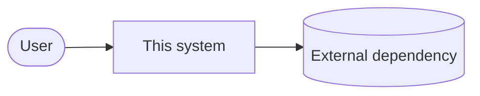

# Architecture

<!-- BOOTSTRAP: greenfield → intended initial shape; brownfield → the system as it is today,
derived from the code. Keep diagrams in Mermaid so agents can edit them. -->

## Context

## Containers / modules

| Module | Responsibility | Path |
|---|---|---|
<!-- BOOTSTRAP -->

## Key flows
<!-- BOOTSTRAP -->

## Cross-cutting concerns
- Auth:
- Config & secrets:
- Logging / observability:
- Error handling:

## Decision index
See `docs/adr/`.
